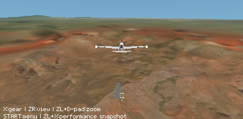
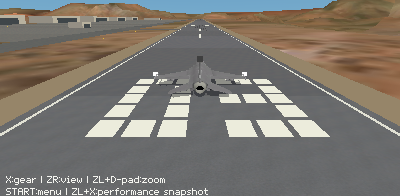
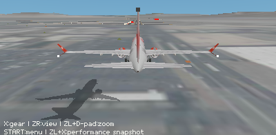
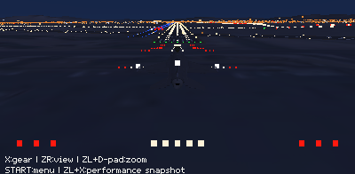
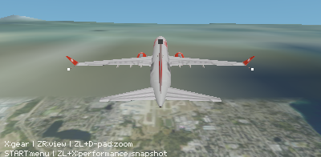
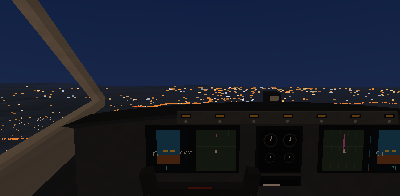
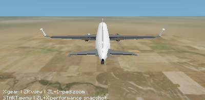
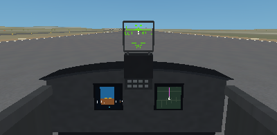

# 3DMicroFlight

A free flight simulator for the New Nintendo 3DS family (New 3DS, New 3DS XL and
New 2DS XL). Formerly CirrusFlight.

- **Five aircraft:** Cirrus SR22, Cirrus Vision SF50, Boeing 737, Airbus A321 and F-16,
  each with its own flight model, exterior model and cockpit.
- **All 48 contiguous US states** in aerial photos (USDA NAIP) on USGS elevation, with
  real airports and runways.
- **City buildings** (v1.0.1) in Las Vegas, Tucson and Duluth, with lidar heights.
- **Day and night:** runway lights, city lights and aircraft navigation lights after dark.
- Clouds and weather, stereoscopic 3D, a touchscreen flight display, engine and wind
  sound, and three save slots.

## Screenshots

Captured on New 3DS hardware (top screen, 400 x 240).

| | |
|---|---|
|  Cirrus SR22 over the red rocks of Sedona, Arizona |  F-16 lined up at Sedona |
|  Boeing 737 on short final at Las Vegas |  F-16 approaching Las Vegas at night |
|  Boeing 737 over Seattle |  737 cockpit over Phoenix at night |
|  Airbus A321 near Denver |  F-16 cockpit and head-up display at Phoenix |

## Download and install

Get the game and the scenery from the
[latest release](https://github.com/zedlavld/3DMicroFlight/releases/latest), then follow
**[INSTALL.md](INSTALL.md)**. In short: a New 3DS-family console with Luma3DS and FBI, a
FAT32 SD card of 64 GB or more, about 30 GB of scenery extracted to the card, and the
CIA installed with FBI.

## Building from source

The game is in [`outputs/CanyonFlight`](outputs/CanyonFlight). It builds with devkitPro
(devkitARM, libctru, citro3d, citro2d): run `make` there to get `3DMicroFlight.3dsx`.
CIA packaging inputs (banner, RSF) are in `work/cia-v34`. The scenery tools are in
`outputs/CanyonFlight/tools`; see
[the project documentation](outputs/CanyonFlight/README.md) for details.

## License and credits

The simulator's own code, tools, documentation, artwork and audio are free to use under
the [MIT licence](LICENSE). The aircraft models and map data keep their own terms; see
[THIRD_PARTY_NOTICES.md](THIRD_PARTY_NOTICES.md) and the
[aircraft credits](outputs/CanyonFlight/third_party/aircraft/ATTRIBUTION.md). Every part
of the game can be used, shared and changed freely, including commercially, as long as
the credits are kept.

3DMicroFlight is an unofficial fan project. It is not affiliated with Nintendo or with
any aircraft manufacturer, and it is not for real-world navigation or flight training.
